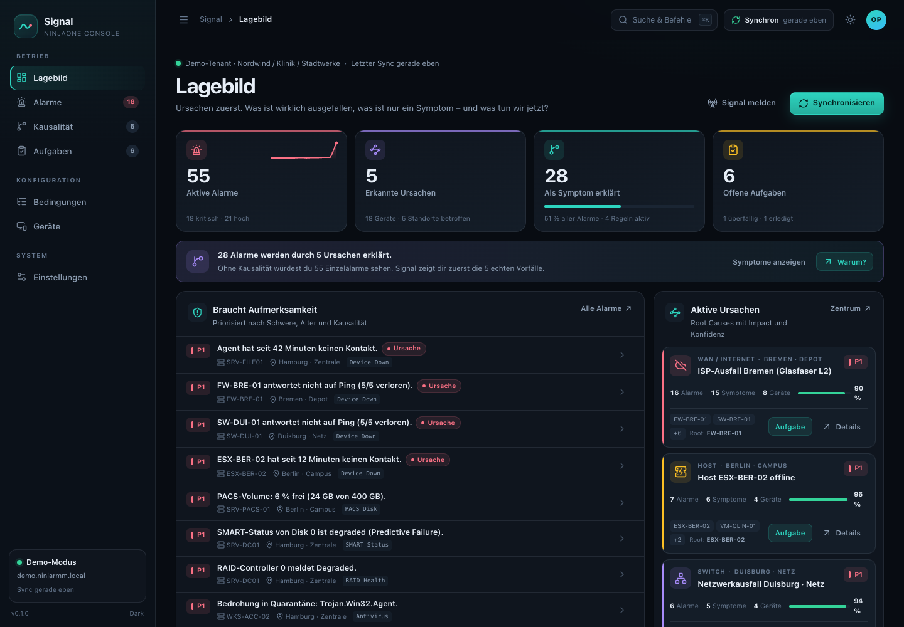
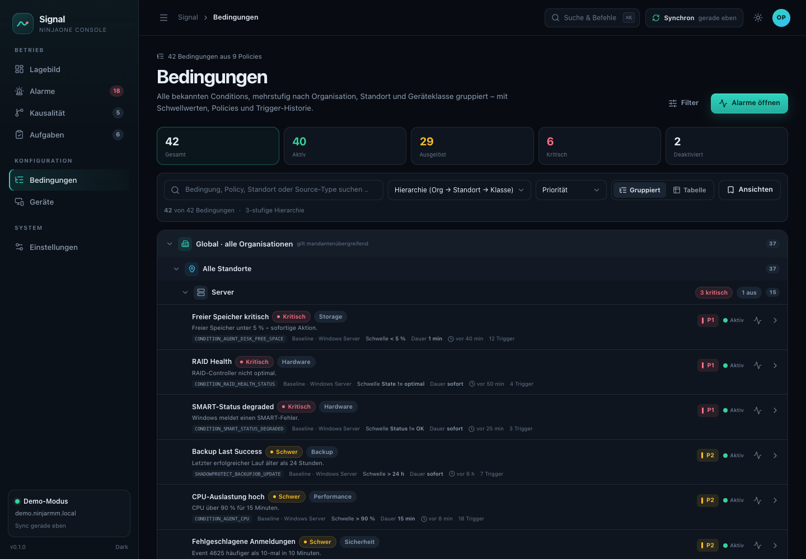
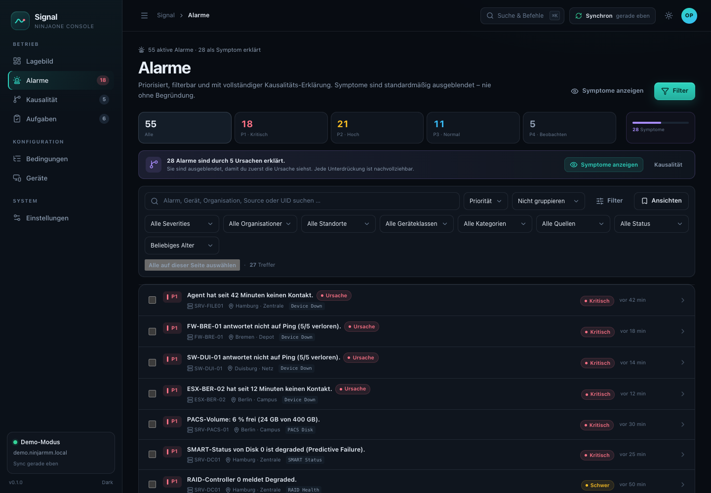
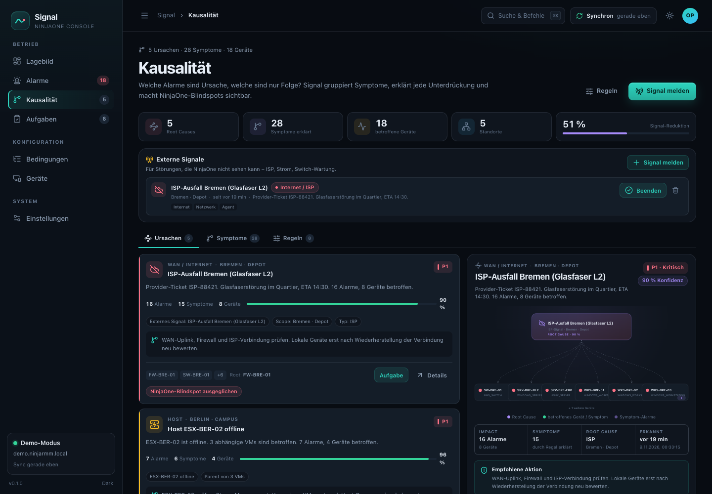
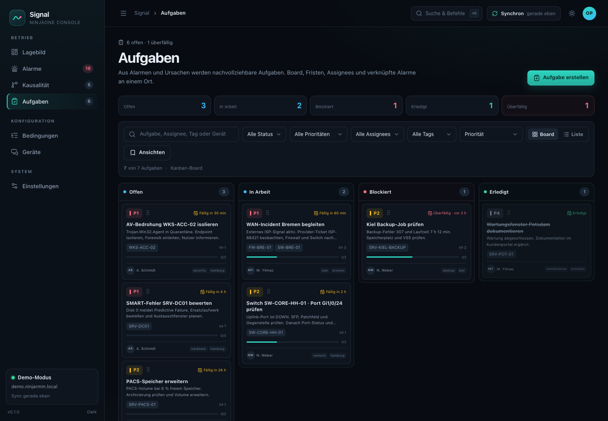
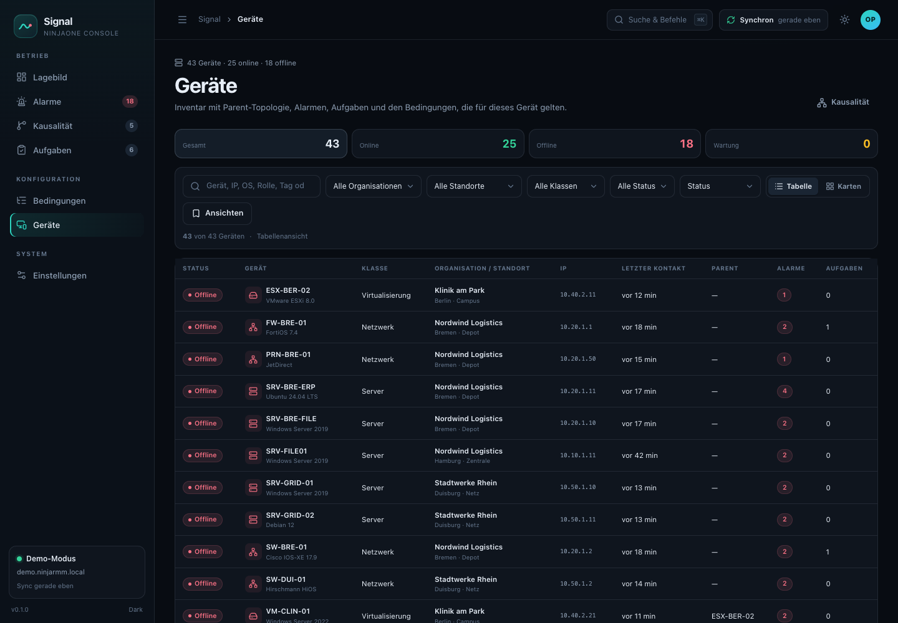
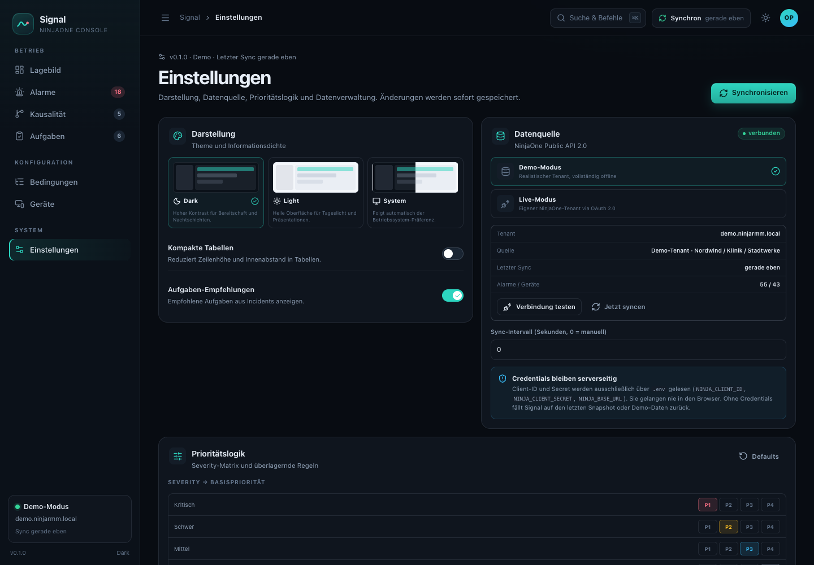
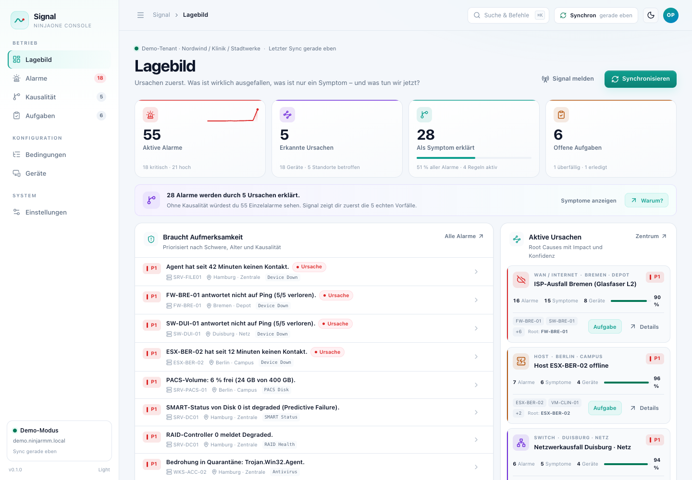
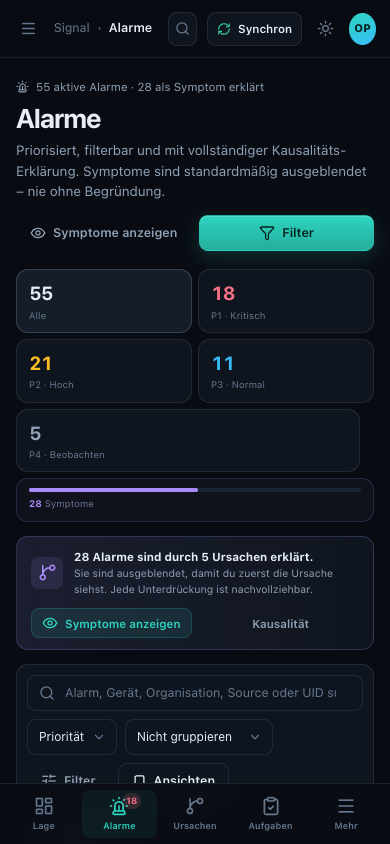

# Signal — Causal Monitoring Console for NinjaOne

**Signal turns NinjaOne alerts into an operational picture: what is actually broken, what is only a symptom, and what to do next.**



Signal is a Bun + TypeScript + React web app that connects to the **NinjaOne Public API 2.0** and adds:

- a hierarchical **conditions explorer** (organization → location → device class → condition),
- a **priority-tuned alert workspace** with saved views, bulk actions and evidence,
- a **causality engine** that suppresses downstream noise (agent offline, failed switch, WAN outage),
- **external outage signals** for things NinjaOne cannot see (ISP, power, switch maintenance),
- and a **task workflow** generated from real alerts and incidents.

> Demo mode is the default. The app is fully explorable without NinjaOne credentials.

## Quick start

```bash
bun install
bun run dev
# http://localhost:3000
```

If port 3000 is occupied:

```bash
PORT=3100 bun run dev
```

### Live mode

```bash
cp .env.example .env
# set NINJA_MODE=live and your OAuth client credentials
bun run dev
```

`NINJA_CLIENT_ID` and `NINJA_CLIENT_SECRET` are read only by the Bun server. They never reach the browser. Region hosts: `https://app.ninjarmm.com` (US), `https://eu.ninjarmm.com` (EU), `https://oc.ninjarmm.com` (Oceania).

## What is inside

| Area | Capabilities |
| --- | --- |
| **Lagebild** | KPIs, root causes, site health, alert volume, activity feed, suppression insight |
| **Bedingungen** | 42 demo conditions, 3-level hierarchy, 7 group-by modes, table view, full facets, detail drawer with trigger history |
| **Alarme** | P1–P4 priority, suppression banner, search/facets/sort/grouping, saved views, bulk acknowledge/task, evidence drawer, manual priority override, NinjaOne reset |
| **Kausalität** | 5 root causes in the demo, causal graph, confidence/evidence, suppression explorer, 8 tunable rules, external signal management |
| **Aufgaben** | Kanban board with drag & drop, list view, CRUD, checklists, due dates, assignees, alert/device links |
| **Geräte** | Inventory, online/offline/maintenance, parent topology, active alerts, tasks, applicable conditions |
| **Einstellungen** | Dark/light/system theme, compact tables, demo/live source, sync, priority matrix/rules, suppression threshold, export, reset |
| **Global** | Command palette (⌘K / Ctrl+K), keyboard navigation (`g d`, `g a`, `g k`, `g t`, …), toasts, responsive mobile navigation |

## Screenshots

| | |
| --- | --- |
|  |  |
| **Conditions hierarchy** | **Alert workspace** |
|  |  |
| **Causality center** | **Task board** |
|  |  |
| **Device inventory** | **Settings** |
|  |  |
| **Light theme** | **Mobile (390 px)** |

## Demo scenario

The demo tenant tells one connected story:

- **Bremen:** ISP/WAN outage. Firewall and switch offline, seven devices offline, HTTP checks red. Signal groups this into one WAN incident and suppresses 15 symptoms.
- **Duisburg:** switch `SW-DUI-01` offline. Three downstream devices and their alerts become symptoms.
- **Berlin:** ESXi host `ESX-BER-02` offline. Three VMs and their tools/snapshot alerts are suppressed via parent topology.
- **Hamburg:** `SRV-FILE01` agent offline with a stale disk warning. The disk alarm is hidden as no longer reliable, but the root cause and a check task remain.
- **Kiel:** `WKS-KIEL-01` agent offline with a stale disk warning.
- **Standalone signals:** SMART failure, RAID degraded, AV threat, stopped services, patch risk, backup failure.

The result: **55 active alerts → 5 root causes + 28 explained symptoms** (51 % signal reduction), while security and hardware alerts stay visible.

## Architecture

```text
React (Bun HTML import) ── /api/* ── Bun.serve
                                    ├── NinjaOne OAuth2 client (token cache, retry, pagination)
                                    ├── normalizer (alerts, devices, policies, activities, health)
                                    ├── SQLite (tasks, signals, settings, rules, alert state, cache)
                                    └── demo tenant (deterministic, seeded)
```

Priority and causality are pure TypeScript functions in `src/shared/` and run in the browser for instant rule changes. The same functions are unit-tested with Bun.

## Documentation

| Document | Purpose |
| --- | --- |
| [docs/PRODUCT.md](docs/PRODUCT.md) | Product vision, personas, jobs, feature set, success metrics |
| [docs/ROADMAP.md](docs/ROADMAP.md) | Delivery roadmap and milestones |
| [docs/TECHNOLOGY.md](docs/TECHNOLOGY.md) | Stack, architecture, security, operations |
| [docs/API_RESEARCH.md](docs/API_RESEARCH.md) | Official NinjaOne API research and constraints |
| [docs/CAUSALITY_ENGINE.md](docs/CAUSALITY_ENGINE.md) | Suppression rules, confidence and examples |
| [docs/UX.md](docs/UX.md) | Information architecture, responsive and a11y rules |
| [docs/QA.md](docs/QA.md) | Verification matrix, commands and results |
| [docs/CHANGELOG.md](docs/CHANGELOG.md) | Incremental delivery log |

## Scripts

```bash
bun run dev        # hot-reloading full-stack dev server
bun run build      # browser bundle in dist/
bun run start      # production server
bun run typecheck  # TypeScript strict
bun test           # priority, causality and normalization tests
bun run check      # typecheck + tests
```

## API limitations (documented, not hidden)

- `/v2/policies` returns policy metadata but **not** condition configuration. Signal derives conditions from activities (`sourceConfigUid`, `sourceName`) and labels their source. In live mode, unknown thresholds are shown as `—`.
- Active `/v2/alerts` responses do not include explicit severity/priority. Signal enriches via `/v2/activities` and its own editable priority rules.
- Switch-port topology is not in the Public API. Signal uses `parentDeviceId`, location, tags and external signals.
- `/v2/tasks` means **scheduled tasks**, not tickets. Signal tasks are local SQLite records; optional PSA integration is future work.
- A WAN outage can make NinjaOne itself unreachable. Signal keeps the last snapshot (`stale` banner) and supports manual ISP/power/switch signals.

See [docs/API_RESEARCH.md](docs/API_RESEARCH.md) for sources and endpoint details.

## Status

MVP is built and verified. Every delivery step is a Git commit; see `git log` and [docs/CHANGELOG.md](docs/CHANGELOG.md).
